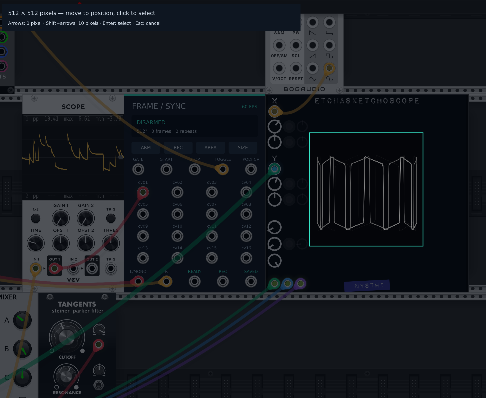

# FrameSync Recorder

Experimental VCV Rack 2 recorder for Linux and Windows x64.

A separately named Rack 2 plugin based on VCV Recorder's framebuffer capture
approach, with 60 fps H.264 video, embedded stereo AAC audio, and 16-channel
frame-onset CSV recording.



*Selecting a scope recording region in VCV Rack on Windows.*

FFmpeg runs as an external process, without a shell or FFmpeg libraries linked
into Rack. See [encoder configuration](#encoder-configuration) for executable
resolution. The source and panel are GPL-3.0-or-later; see
[license and upstream attribution](LICENSE.md).

See [validation results and limits](VALIDATION.md) and
[Windows setup](WINDOWS-SETUP.md). Short functional captures are not a universal
scope-latency calibration.

## Install

Build a package from source using the instructions below; no public binary download
is required. In Rack, choose **Help → Open user folder**. Copy the matching x64
`.vcvplugin` from `dist/` into that folder's `plugins-lin-x64` (Linux) or
`plugins-win-x64` (Windows) directory, then restart Rack to extract and load it.
Search the module browser for **FrameSync**. It installs alongside VCV Recorder
and does not replace it. See the [official installation guide](https://vcvrack.com/manual/Installing).

## Capture a take

1. Add **FrameSync Recorder**. Set Rack's GUI frame rate to 60 fps or higher.
2. Right-click and choose an output folder. SIZE switches 512×512 / 1024×1024.
3. Click AREA, move the square over the scope, then click to select. Arrow keys
   nudge one physical pixel, Shift+arrows ten. Enter confirms; Escape cancels.
   The full selected square must fit inside Rack's framebuffer.
4. Patch CV into the numbered inputs, or use POLY CV for up to 16 channels.
   A connected numbered input overrides its corresponding poly channel.
   Column names and the filename prefix are editable in the context menu.
   Column names must be unique; reserved timing-column names cannot be reused.
5. Patch your mix into **L/MONO** and **R** on the bottom row. If only L/MONO
   is patched, it feeds both audio channels. With neither patched, the MP4 is silent.
6. Click ARM. Wait for READY (also a 10 V output). TOGGLE accepts one trigger
   to start and the next to stop. Alternatively, gate high starts a take and
   gate low stops it, or use separate START/STOP triggers. REC toggles manually.
   Choose one control method; leave GATE unpatched when using trigger inputs.
7. SAVED emits a pulse after both files are finalized. The recorder then
   prepares the next numbered take. Wait for READY before starting again.
   DISARM cancels readiness, or stops an active take and disables auto-rearm.

Outputs are `take-0001.mp4`, `take-0001.csv`, and diagnostic `take-0001.json`.
The encoder's log has the same basename. A recording interrupted by an error
keeps available `.partial.*` files and an error manifest. Temporary audio/video
files are merged automatically during SAVING and removed after a successful take.
Files are reserved together, and existing takes are never intentionally replaced.
No recording or arming is resumed automatically when opening a saved Rack patch.

The crop is relative to Rack's window in physical framebuffer pixels. Moving
the window is fine. Panning/zooming the patch changes what occupies the crop;
reselect it as needed. Resizing the window so the crop no longer fits stops
the take with an error. Keep menus, cables, tooltips, and other Rack overlays
outside the selected area. The selection overlay is removed before arming.

## One-bar or one-sequence takes with TOGGLE

Patch a pulse at the beginning of each bar (or complete sequence) into **TOGGLE**.
Arm and wait for READY: the next rising edge starts a take, and the following
rising edge stops it. This records the interval between those two pulses.
For example, one 4/4 bar at 120 BPM is two seconds: 120 video frames at 60 fps.
At tempos where a bar is not a whole number of video frames, the final frame
rounds the video duration up by less than 1/60 second; trigger timing remains
sample-accurate. The existing CSV/MP4 pairing and delay compensation still apply.

If the pulse continues, the third edge starts another take once READY, and the
fourth stops it. This alternates recording and waiting across successive bars;
it does not split every bar into an uninterrupted series of recordings.
For a single take, disarm after it stops or stop sending TOGGLE pulses.

A held-high signal toggles only once. Pulses while disarmed, preparing, or saving
are ignored and never queued for later. Wait for READY before a fresh start.
If START and STOP rise on the same engine sample, **STOP wins**: a waiting
recorder stays waiting, and an active recording stops. STOP also takes priority
over TOGGLE. TOGGLE and a manual REC click on the same sample toggle only once.

Existing saved cable connections are preserved when updating to version 2.1.0.
The bottom output jacks move to make room for audio; their connections stay intact.

## Stereo audio

Audio comes from the module's **L/MONO** and **R** inputs, not desktop sound or
an audio device's monitor. Split the same mixer outputs to your listening output
and FrameSync. Recording does not depend on which audio interface is selected.
Each audio jack sums its polyphonic channels, as VCV Recorder does. An unpatched
R copies L. ±10 V maps to digital full scale; larger signals clip. A normal ±5 V
audio signal records at half scale. CV inputs retain their raw voltage range.

Audio is sampled on every Rack engine tick from the start trigger, up to but
excluding the stop trigger's sample. Video uses the same recording origin and
engine sample clock. The MP4 contains 48 kHz stereo AAC at 320 kb/s; other engine
rates are resampled automatically. No microphone or hardware loopback is used.

The encoder writes video during recording. After STOP it encodes the captured
audio and embeds it in the MP4, copying the already encoded video without another
video encode. Wait for **SAVED** before using the files or quitting Rack. This is
part of the recorder's save operation; no external editing step is needed.

## Optional CSV delay compensation

Disarm, then right-click → **CSV delay compensation**. Choose **Off** (default)
or **1–4 frames** (16.7–66.7 ms). Two frames (33.3 ms) is a useful comparison with
the historical display-lag measurement. The panel shows `CSV +2f` for this setting.
The selection is saved in the patch. An existing 2.0.x correction setting keeps
its selected amount when loading, but now applies to CSV only.

**Audio and video timing stay unchanged.** With two frames selected, CSV row n
contains the CV from two frames before that audio/video frame. This delays CV
changes to line up with a display that draws them two frames late. The recorder
retains recent CV history, so the opening rows use real values from before the
start trigger. If the module has only just been added or its sample rate changed,
unavailable history is held at the earliest available value and flagged in the
CSV. Let the engine run briefly before starting for complete history.

Unlike version 2.0.x, compensation no longer advances the video or captures a
post-roll after STOP. You still wait for SAVED while the files finish writing.
This remains a fixed offset, not automatic scope-latency tracking. Compare Off
and two frames in your actual patch; variable GUI delay can still vary alignment.

## Timing and data

`frame` is zero-based and maps to decoded MP4 presentation order. At 60 fps,
`time_seconds = frame / 60`. `sample_index` identifies the audio/video frame onset,
relative to the recording trigger: `ceil(frame * engine_sample_rate / 60)`.
At 48 kHz this is exactly 800 samples per frame.

With compensation Off, CV is sampled at that onset. With K frames of CSV delay,
its source sample is `ceil((frame - K) * engine_sample_rate / 60)`. The appended
`cv_sample_index` and `cv_time_seconds` columns identify that source, including
negative values for pre-trigger history. `cv_history_clamped` is 1 only when the
requested history was unavailable and the earliest available value was held.
The JSON records `cv_delay_frames`, `cv_delay_ms`, and clamped-row count.

CV values are raw volts without gain or normalization. Disconnected channels
contain zero; values outside ±10 V are preserved. There is exactly one CSV row
per video frame. Existing column names and frame numbering are unchanged.

Video selects the framebuffer read nearest each scheduled frame onset, using
one capture of lookahead. The `capture_sample_index` and `capture_offset_ms`
columns describe that read relative to the frame onset, independently of CSV
correction. They do not measure when the scope internally updated its pixels.
`repeated_image` flags reuse of the same capture, not two identical-looking
captures. Slow GUI updates may cause repeats; timestamps are never shifted to
hide them. JSON diagnostics also include audio sample counts and clipping counts.

Audio/CV capture never writes files, allocates memory, or waits on the encoder.
Video capture runs on the GUI thread; a background worker handles file writing
and encoding. Audio/CV queue overflow, missing audio samples, non-finite recorded
input, a changed engine rate during recording, or encoder failure fails the take.
A full GUI capture queue instead drops that framebuffer read and increments
`capture_queue_overflows` in the JSON diagnostics; scheduled video frames and CSV
rows continue and may reuse images. Inspect this counter alongside `repeated_image`
and capture offsets when evaluating a take.

A stop between video-frame boundaries leaves a final whole video frame, so the
clip duration may exceed the gate by less than 1/60 second. Audio stops at the
exact gate boundary; only the remaining fraction of that last frame is padded
with silence. Video, audio, and CSV then share the same clip duration.

## Sync Check

Connect Recorder READY → Sync Check READY IN, Sync Check GATE OUT → Recorder
GATE, and Sync Check POLY CV → Recorder POLY CV. Capture its barcode display,
arm the recorder, and press RUN ONCE. The first CV column records the integer
display code; the next twelve carry its binary bits. This lets you measure the
visual capture delay against the recorded CV without LOGAN20.

`examples/Sync-check.vcv` contains this wiring. Choose an output folder and AREA
over the display, click ARM, then press RUN ONCE. The patch does not use an audio
device. Open it as a separate patch after saving your current work.

The scope's own drawing and Rack's display updates add latency. A fixed 60 fps
file and exact CV timestamps do not guarantee that a GUI scope draws every
intermediate state. A busy or hidden Rack window can produce repeated images.
Keep Rack visible while capturing. Use the Sync Check to assess the current
system load. Apply a measured correction explicitly in the recorder's context menu.

## Build and test

Install VCV Rack 2 and obtain the **official Rack SDK for the target platform**
from [VCV's build guide](https://vcvrack.com/manual/Building). The recorded builds
used SDK 2.6.6. Follow that guide's platform build-environment prerequisites;
building Rack itself is not necessary when using the SDK. FrameSync requires a
C++17 compiler, GNU make, and jq; packaging uses zstd and archive tools. Keep the
absolute source and SDK paths free of spaces.

Runtime recording requires an external [FFmpeg](https://ffmpeg.org/download.html)
with libx264 and AAC encoders. Automated output checks additionally need **Python 3,
ffmpeg, and ffprobe on PATH**. No FFmpeg binary or Rack SDK is bundled.

### Linux x64

Use the Linux x64 SDK and Linux compiler/build prerequisites. From the source
checkout:

```sh
make -j4 RACK_DIR=/absolute/path/to/Rack-SDK
make test RACK_DIR=/absolute/path/to/Rack-SDK
make test-controls RACK_DIR=/absolute/path/to/Rack-SDK
make test-races RACK_DIR=/absolute/path/to/Rack-SDK
make test-races-negative RACK_DIR=/absolute/path/to/Rack-SDK
make test-posix RACK_DIR=/absolute/path/to/Rack-SDK
make dist RACK_DIR=/absolute/path/to/Rack-SDK
```

The package is `dist/FrameSync-2.1.2-lin-x64.vcvplugin`. `make test` and
`make test-controls` include their Python output checks. The race tests force
specific engine/worker interleavings; the negative tests build isolated copies
with the old cancellation predicates and require the expected take-loss failures.
`make test-posix` checks Linux encoder paths, failures, reservations, and shutdown.

### Windows x64

Use the Windows x64 SDK and the official MSYS2 **MinGW64** build environment
(not the default MSYS shell). From the same integrated source in MinGW64:

```sh
make -j4 RACK_DIR=/c/dev/Rack-SDK
make dist RACK_DIR=/c/dev/Rack-SDK
```

The package is `dist/FrameSync-2.1.2-win-x64.vcvplugin`. For tests, put Python 3
and native Windows FFmpeg/ffprobe on PATH. The SDK provides `libRack.dll.a`;
module-level tests also need an installed Rack's `libRack.dll` and dependencies.
Set `RACK_RUNTIME_DIR` to that Rack installation, for example:

```sh
export FRAMESYNC_FFMPEG='C:/tools/ffmpeg/bin/ffmpeg.exe'
export PATH='/c/tools/ffmpeg/bin:/c/path/to/python:'"$PATH"
make test RACK_DIR=/c/dev/Rack-SDK
make test-controls RACK_DIR=/c/dev/Rack-SDK RACK_RUNTIME_DIR='/c/Program Files/VCV/Rack2Pro'
make test-windows RACK_DIR=/c/dev/Rack-SDK
make test-races RACK_DIR=/c/dev/Rack-SDK
make test-races-negative RACK_DIR=/c/dev/Rack-SDK
```

`make test` invokes `tests/check_outputs.py`. Its Python
command defaults to `python` on Windows and can be overridden with `PYTHON=python3`.
`FRAMESYNC_FFMPEG` must use a native Windows path, not an MSYS-only `/c/…` path.
When moving a patch between platforms, choose a valid output folder and reselect
AREA for the current framebuffer size/display scaling. Keep Rack's engine running
and its window visible during recording.

## Encoder configuration

On both platforms, a nonempty module `ffmpegPath` takes precedence over
`FRAMESYNC_FFMPEG`. If neither is set, the fallback is `ffmpeg.exe` on PATH for
Windows or `/usr/bin/ffmpeg` for Linux. Use an absolute executable path for an
explicit module setting or `FRAMESYNC_FFMPEG`.

The module constructor reads the first line of
`<Rack user folder>/FrameSync-ffmpeg.txt` into `ffmpegPath` on **both** platforms.
Use one UTF-8 executable path without surrounding quotes. A saved patch's
`ffmpegPath` overrides that initial value, including when saved as an empty
string. While disarmed, **Choose FFmpeg executable…** changes the module setting,
which is saved in the patch; it does not update the defaults file. A nonempty
per-user default therefore also takes precedence over the environment variable.

For environment-driven resolution, remove or empty the defaults file before
creating a new module. An existing saved nonempty `ffmpegPath` must also be cleared
(set it to `""` in the module's saved JSON data in a copy of the patch while Rack
is closed), or use a fresh module.

## Platform validation status

Version 2.1.2
integrates the Windows backend and strengthens the shared START/disarm handling.
The integrated source has fresh Linux validation; native Windows execution of
2.1.2 and interactive Windows AREA testing remain pending. Prior Windows 2.1.1
results are recorded separately in [validation](VALIDATION.md).
macOS is not yet supported.
